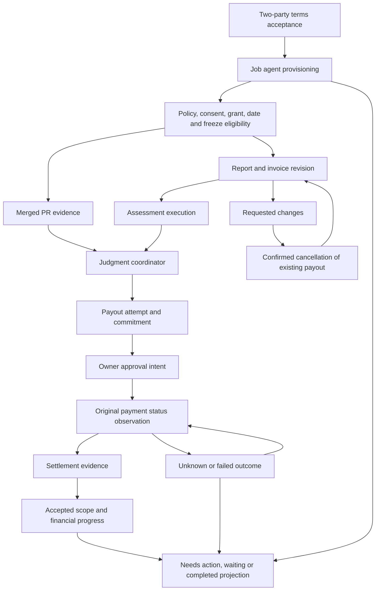

# Implicit state machines in Paperwork / Desk

Audit date: November 11, 2026. Scope: the current `demo` working tree, based on Git HEAD `77d7416`, including its uncommitted and untracked application changes. This is a source audit, not a hosted-runtime assessment.

The app contains a network of independently meaningful lifecycles. The most consequential implicit machines are encoded by combinations of nullable fields, timestamps, stored status strings, request identities, SQL indexes, and browser storage. Several individual status sets are already explicit; their cross-record transition rules remain distributed.

The inventory below separates durable business state, observed external state, derived views, transient client state, and concurrency controls. Repeated renderings of a server state are cross-referenced rather than counted as new business machines. Small presentation states and demo-only models appear at the end. Pure validation, hashing, money conversion, and stateless transport adapters are outside the inventory.

## How the major machines connect

This diagram shows dependencies, not every transition of each constituent machine.

## Jobs, reports, judgments, and payouts

| ID | Machine / state owner | Representation, transitions, and guards | Source |
| --- | --- | --- | --- |
| J01 | Terms acceptance — durable | `rep_sig × contractor_sig` encodes unsigned, representative only, builder only, and both signed. Acceptance binds the account, terms hash, signing recipient, nonce, and full-access key. Both signatures gate setup and report filing. | [engine.ts:243](../src/server/engine.ts#L243), [engine.ts:255](../src/server/engine.ts#L255), [db.ts:24](../src/server/db.ts#L24) |
| J02 | Overall job eligibility — derived | Signatures, agent stage, freeze, clock, live balance, and payout history produce `needs_signatures`, setup stages, `needs_funding`, `active`, `frozen`, or `ended`. The start date is a separate action guard. `active` is therefore a coarse projection, not a complete permission state. | [engine.ts:1231](../src/server/engine.ts#L1231), [engine.ts:1370](../src/server/engine.ts#L1370) |
| J03 | Immutable report/invoice revisions — durable | `submitted → proposed → settled / closed / disputed`; no payable proposal can close submitted directly. Feedback produces `changes_requested` or `changes_pending`. A dispute can resume proposed after explicit resolution or settle on late full payment evidence. New revisions are immutable; duplicate client identity requires matching content, and invoice/revision numbers are unique. | [jobs.ts:22](../src/shared/jobs.ts#L22), [engine.ts:279](../src/server/engine.ts#L279), [engine.ts:325](../src/server/engine.ts#L325), [engine.ts:604](../src/server/engine.ts#L604), [engine.ts:962](../src/server/engine.ts#L962), [db.ts:215](../src/server/db.ts#L215) |
| J04 | Assessment execution — transient | Idle → reading response headers/body → validated result, failure, or timeout. There is no durable `assessing` row. The contract mutex holds during assessment; only successful assessment reaches the proposal transaction. The report assessor has a bounded deadline and ignores late results. | [job-judge.ts:9](../src/server/job-judge.ts#L9), [engine.ts:328](../src/server/engine.ts#L328), [engine.ts:350](../src/server/engine.ts#L350) |
| J05 | Feedback/cancellation handshake — durable composite | Feedback before a proposal opens revision immediately. Feedback after a proposal sets `changes_pending`; revision waits for authoritative cancellation of the original payment. An uncertain payment continues observation. A raced external approval may produce payment instead of cancellation. | [engine.ts:363](../src/server/engine.ts#L363), [engine.ts:416](../src/server/engine.ts#L416), [engine.ts:684](../src/server/engine.ts#L684), [engine.ts:872](../src/server/engine.ts#L872) |
| J06 | Judgment coordinator — durable plus computed decisions | Outcomes are `pending`, `approved`, `rejected`, `dropped`, `nothing`, `disputed`. Internal decisions include wait, next sequence, automatic retry, representative review, re-owe, and close. One judgment may coordinate several capped payments. SQL permits one pending judgment per job. | [payouts.ts:179](../src/server/payouts.ts#L179), [engine.ts:494](../src/server/engine.ts#L494), [engine.ts:865](../src/server/engine.ts#L865), [db.ts:214](../src/server/db.ts#L214) |
| J07 | Payout execution — durable, partly explicit | The attempt is saved as `pending` before external I/O. Preflight and platform answers lead to `blocked`, `waiting`, `unknown`, `held`, `processing`, `refused`, `paid`, `failed`, `rejected`, or `dropped`. Transition helpers already exist; execution and recovery orchestration are spread across the engine. | [payouts.ts:107](../src/server/payouts.ts#L107), [engine.ts:679](../src/server/engine.ts#L679), [engine.ts:710](../src/server/engine.ts#L710), [engine.ts:827](../src/server/engine.ts#L827) |
| J08 | Payout decision / owner approval — durable composite | Held payment → prepare approve/reject intent → wallet or confirmation page → submitted/unknown owner step → observe the original payment. Exact payee, asset, chain, and amount are checked before approval. A submitted or uncertain decision blocks a replacement; proven unsubmitted expiry permits a new intent. Uses O03 underneath. | [engine.ts:438](../src/server/engine.ts#L438), [engine.ts:619](../src/server/engine.ts#L619), [engine.ts:636](../src/server/engine.ts#L636), [engine.ts:653](../src/server/engine.ts#L653) |
| J09 | Failed-payment resolution / dispute — durable composite | `failed + resolution=null` can acquire `arrived`, `reowe`, `rejected`, or `disputed`. V3 budget-releasing resolutions require non-execution proof and no contradictory transaction evidence. Dispute can close business review while preserving the monetary commitment. Later settlement is reconciled under the original identities. | [engine.ts:585](../src/server/engine.ts#L585), [engine.ts:758](../src/server/engine.ts#L758), [engine.ts:962](../src/server/engine.ts#L962), [payouts.ts:43](../src/server/payouts.ts#L43) |
| J10 | Retry identity / payout sequencing — durable composite | `(seq, attempt, state, code, retry_at, auto_retry)` determines same-ID retry, new attempt, or next capped payment. Transient/preflight failures and `not_found` preserve identity. A recorded refusal or permitted re-owe can advance attempt. Policy-change refusal allows one automatic retry. | [payouts.ts:30](../src/server/payouts.ts#L30), [payouts.ts:124](../src/server/payouts.ts#L124), [engine.ts:552](../src/server/engine.ts#L552), [engine.ts:907](../src/server/engine.ts#L907) |
| J11 | Request-identity conflict quarantine — durable hidden subtype | `blocked + code=request_conflict` follows a different protocol from ordinary blocked requests. It retains commitment, observes the conflicting platform record for display, and cannot be resent, adopted as the other payment, or dropped as never recorded. | [payouts.ts:126](../src/server/payouts.ts#L126), [engine.ts:788](../src/server/engine.ts#L788), [engine.ts:831](../src/server/engine.ts#L831) |
| J12 | Financial commitment — ledger-derived | Independently classifies attempts as uncommitted, potentially payable/unpaid, paid, manually reported arrived, or disputed commitment. Unknown/live and most failed attempts consume headroom. Proven rejection/refusal and permitted resolutions release it. This classification determines later invoice and payout capacity. | [payouts.ts:39](../src/server/payouts.ts#L39), [payouts.ts:49](../src/server/payouts.ts#L49), [payouts.ts:57](../src/server/payouts.ts#L57), [engine.ts:1321](../src/server/engine.ts#L1321) |
| J13 | Accepted deliverable progress — ledger-derived | Completion advances through `0 / .25 / .5 / .75 / 1`. Only approved judgments carry accepted progress forward; a fresh model result alone does not advance that memory. Progress and committed money jointly determine what remains owed. | [judge.ts:6](../src/server/judge.ts#L6), [judge.ts:92](../src/server/judge.ts#L92), [engine.ts:1352](../src/server/engine.ts#L1352) |
| J14 | PR review memory — durable | Unreviewed → approved or rejected. Rejected PRs are excluded from later runs; prior approved reviews affect later escalation. Dropping a judgment and rejecting it therefore have different future behavior. | [engine.ts:515](../src/server/engine.ts#L515), [engine.ts:520](../src/server/engine.ts#L520), [engine.ts:944](../src/server/engine.ts#L944) |
| J15 | Job freeze — observed, cached | Unfrozen ↔ frozen follows authoritative policy reads; an unavailable read retains the last observation. Freeze gates actions and preflight without deleting payment identity. Unfreeze can resume the original blocked request after policy checks. | [engine.ts:710](../src/server/engine.ts#L710), [engine.ts:1245](../src/server/engine.ts#L1245), [engine.ts:1370](../src/server/engine.ts#L1370) |
| J16 | Payee registration observation — cached | Nullable `payee_registered` represents unknown (unread or failed chain read), unregistered, or registered. Builder acceptance records a chain observation. The platform independently checks actual withdrawal eligibility later. | [engine.ts:268](../src/server/engine.ts#L268), [db.ts:33](../src/server/db.ts#L33) |
| J17 | Verification verdict — derived | Incomplete, green, or red comes from signatures, policy, grant, consents, freeze, and platform observation. This is a read model; it does not own provider policy transitions. | [engine.ts:982](../src/server/engine.ts#L982), [engine.ts:1003](../src/server/engine.ts#L1003), [engine.ts:1034](../src/server/engine.ts#L1034) |
| J18 | Personal-job attention — derived, role-sensitive | `needs_action / waiting / completed` is a priority-ordered projection over signatures, owner steps, submissions, payments, scope total, dates, setup, freeze, and viewer role. Unknown money takes priority; completed requires confirmed full-scope platform payment and no unfinished commitment. | [attention.ts:21](../src/server/jobs/attention.ts#L21), [attention.ts:32](../src/server/jobs/attention.ts#L32), [attention.ts:38](../src/server/jobs/attention.ts#L38) |
| J19 | Contract mutation serialization — process-local concurrency | Idle → running with queued followers → next holder → idle. Release occurs in `finally`. SQL partial indexes separately enforce one open judgment, submission, and payout; they are part of the durable protocol. | [payouts.ts:210](../src/server/payouts.ts#L210), [engine.ts:94](../src/server/engine.ts#L94), [db.ts:214](../src/server/db.ts#L214), [db.ts:233](../src/server/db.ts#L233), [db.ts:273](../src/server/db.ts#L273) |

Two important representational details:

- `resolved` and `disputed` in the payout API are projections of stored `failed + resolution`, rather than independent durable attempt states. See [engine.ts:1167](../src/server/engine.ts#L1167).
- `isPaid()` can count a representative's explicitly labeled `arrived` resolution for accounting. The personal-job completion projection separately requires platform `paid` evidence. See [payouts.ts:57](../src/server/payouts.ts#L57) and [attention.ts:38](../src/server/jobs/attention.ts#L38).

## Job provisioning, authority, and policy

| ID | Machine / state owner | Representation, transitions, and guards | Source |
| --- | --- | --- | --- |
| O01 | Job-agent provisioning — durable | `needs_setup → needs_create → needs_consent → needs_grant → needs_policy → policy_pending → ready`. `needs_consent` contains two substates, distinguished by the payout consent ID. Requires both terms signatures. Lost setup replies recover through the original reservation. | [db.ts:38](../src/server/db.ts#L38), [onboarding.ts:84](../src/server/onboarding.ts#L84), [onboarding.ts:170](../src/server/onboarding.ts#L170), [onboarding.ts:204](../src/server/onboarding.ts#L204) |
| O02 | Setup/consent signing challenge — durable | Absent → live `pending_sign` → consumed, or expired → replacement. Exact message, nonce, recipient, step, and deadline are retained across reloads. Stale/nonmatching signatures are refused. | [onboarding.ts:160](../src/server/onboarding.ts#L160), [onboarding.ts:170](../src/server/onboarding.ts#L170) |
| O03 | Owner intent execution — durable | `prepared → unknown` is claimed transactionally before external submission. Submission/status then establishes `submitted`, `success`, `failed`, or `expired`. Wallet and externally signable confirmation intents have different expiry/observation rules. Approval votes require payment-specific reconciliation in J08. | [db.ts:62](../src/server/db.ts#L62), [onboarding.ts:224](../src/server/onboarding.ts#L224), [onboarding.ts:280](../src/server/onboarding.ts#L280), [onboarding.ts:336](../src/server/onboarding.ts#L336) |
| O04 | Successful owner intent application — durable reconciliation | Remote success recorded → effect not yet visible → local setup advanced. Identity reads establish creation; grant success chooses initial policy setup or return to ready; policy success enters `policy_pending`. Reapplying a recorded success avoids issuing another owner action. | [onboarding.ts:232](../src/server/onboarding.ts#L232), [onboarding.ts:374](../src/server/onboarding.ts#L374) |
| O05 | Policy applicability / signed-policy match — observed | Provider `NONE / SIGNED / APPLIED / FAILED`, synchronization, `notInForce`, revision/digest, freeze, and whole-policy matching jointly decide eligibility. A successful owner signature is insufficient: the signed revision must apply and match the terms. Failed application stops progress for review. | [port.ts:69](../src/server/platform/port.ts#L69), [onboarding.ts:125](../src/server/onboarding.ts#L125), [policy-request.ts:49](../src/shared/policy-request.ts#L49), [engine.ts:710](../src/server/engine.ts#L710) |
| O06 | Consent lifetime / capability — external, locally recorded | Payout consent runs to job end; owner/read consent runs through the grace period, subject to the maximum lifetime. Effective capability also depends on scope, agent identity, revocation, and the signing key still being valid. Stored consent presence is distinct from current authority. | [onboarding.ts:112](../src/server/onboarding.ts#L112), [onboarding.ts:191](../src/server/onboarding.ts#L191), [port.ts:123](../src/server/platform/port.ts#L123), [fake.ts:338](../src/server/platform/fake.ts#L338) |
| O07 | Payout-grant renewal — durable plus observed | Ready → grant missing/expired/near expiry → `needs_grant`, with the former successful grant step expired → fresh signed grant → ready when a policy already exists. This is a loop through provisioning, rather than a one-way setup wizard. | [onboarding.ts:387](../src/server/onboarding.ts#L387), [onboarding.ts:405](../src/server/onboarding.ts#L405), [engine.ts:710](../src/server/engine.ts#L710) |

## Agent Market

| ID | Machine / state owner | Representation, transitions, and guards | Source |
| --- | --- | --- | --- |
| M01 | Agency setup — durable | `needs_setup → needs_create → needs_consent → needs_grant → needs_registration → ready`. Wallet and DAO owners take separate approval paths; creation also waits for identity visibility. | [market/db.ts:7](../src/server/market/db.ts#L7), [agencies.ts:147](../src/server/market/agencies.ts#L147), [agencies.ts:201](../src/server/market/agencies.ts#L201) |
| M02 | Market setup/consent signing challenge — durable | Absent → live saved payload/nonce → consumed or expired/replaced. Valid challenges survive repeated next-step calls. This is a separate instance of O02, stored on the agency. | [agencies.ts:185](../src/server/market/agencies.ts#L185), [agencies.ts:201](../src/server/market/agencies.ts#L201) |
| M03 | DAO approval request — durable plus external | `pending → done / expired` for setup, consent, owner actions, and hire votes. Indeterminate reads retain the existing vote; terminal evidence permits renewal. Voting and provider-intent validity have distinct deadlines. | [market/db.ts:32](../src/server/market/db.ts#L32), [agencies.ts:230](../src/server/market/agencies.ts#L230), [agencies.ts:251](../src/server/market/agencies.ts#L251), [hires.ts:248](../src/server/market/hires.ts#L248) |
| M04 | Market owner action — durable | `prepared → unknown` before submit; later `submitted → success / failed / expired` by observation. Applies to create, grant, freeze, and unfreeze. External confirmation/DAO actions cannot be replaced solely because their local deadline passed. | [agencies.ts:314](../src/server/market/agencies.ts#L314), [agencies.ts:358](../src/server/market/agencies.ts#L358), [agencies.ts:410](../src/server/market/agencies.ts#L410), [agencies.ts:441](../src/server/market/agencies.ts#L441) |
| M05 | Market owner-success application — durable reconciliation | Recorded remote success → effect awaiting read → agency setup advances. Replays local application after a crash while preserving the original action. | [agencies.ts:327](../src/server/market/agencies.ts#L327), [agencies.ts:447](../src/server/market/agencies.ts#L447), [agencies.ts:461](../src/server/market/agencies.ts#L461) |
| M06 | Market freeze — observed | Unread, unfrozen, or frozen. Approval and same-ID resend require a fresh observed unfrozen result. Freeze/unfreeze run through M04 and retain historical payment outcomes. | [hires.ts:87](../src/server/market/hires.ts#L87), [hires.ts:104](../src/server/market/hires.ts#L104), [hires.ts:192](../src/server/market/hires.ts#L192), [agencies.ts:475](../src/server/market/agencies.ts#L475) |
| M07 | Market payment-key registration — observed | Unread → unregistered → registered. While unregistered, setup supplies a registration transaction; observing registration advances the agency to ready. | [agencies.ts:166](../src/server/market/agencies.ts#L166) |
| M08 | Earnings deposit address — durable observation | Absent → issued address, crossed with address expiry and token registration unknown/false/true. Accepted assignments snapshot the deposit address shown at acceptance. This address differs from the market payment key in M07. | [agencies.ts:495](../src/server/market/agencies.ts#L495), [agencies.ts:508](../src/server/market/agencies.ts#L508), [worker.ts:155](../src/server/market/worker.ts#L155) |
| M09 | Hire quote/approval/payment — durable | Wallet: `quoted → hiring → paid / not_charged / refused / unknown`. DAO adds uncertain filing, `voting`, and `vote_expired`; a renewed vote keeps the same hire request ID. Only quoted records can be discarded. Wallet `not_found` can resend under the original ID. | [market/db.ts:64](../src/server/market/db.ts#L64), [hires.ts:53](../src/server/market/hires.ts#L53), [hires.ts:100](../src/server/market/hires.ts#L100), [hires.ts:242](../src/server/market/hires.ts#L242) |
| M10 | DAO hire filing recovery — durable hidden subtype | `(state=unknown, dao_vote_id, code)` distinguishes filing unknown, recovered vote, and unavailable recovery. Unknown filing blocks another hire for that agency. Recovery uses original identity/terms and an expired deadline to prevent creation of a replacement approval. | [hires.ts:94](../src/server/market/hires.ts#L94), [hires.ts:115](../src/server/market/hires.ts#L115), [hires.ts:143](../src/server/market/hires.ts#L143), [hires.ts:161](../src/server/market/hires.ts#L161), [sdk.ts:40](../src/server/market/sdk.ts#L40) |
| M11 | Hired task / deliverable observation — remote-owned | `task_state`, `task_id`, and deliverable are recorded independently of hire payment state. The app stores remote task strings rather than owning a task transition graph. Current follow-up is keyed to payment liveness, creating the conditional gap described below. | [hires.ts:216](../src/server/market/hires.ts#L216), [hires.ts:242](../src/server/market/hires.ts#L242), [market/db.ts:66](../src/server/market/db.ts#L66) |
| M12 | Worker assignment lifecycle — remote-owned, cached | Open-ended remote status; local behavior understands `in_progress`, `submitted`, and `accepted`. Rework can return to in-progress. Webhooks establish observations; polling reads current status. Acceptance time and deposit snapshot are recorded once. | [market/api.ts:16](../src/server/market/api.ts#L16), [worker.ts:105](../src/server/market/worker.ts#L105), [worker.ts:135](../src/server/market/worker.ts#L135), [worker.ts:264](../src/server/market/worker.ts#L264) |
| M13 | Worker submission and lost-reply recovery — durable composite | `submit_state × submit_phase × attempt_id × baseline × assignment.status`. `none → submitting/preflight → submitting/posting → submitted`; uncertain POST → unknown; definite refusal → none. Recovery compares immutable deliverable versions and exact Markdown: matching arrival → submitted, proven absence → none/not-arrived, inconsistent history → unknown. Exact retry preserves ID/body and rechecks arrival. | [market/db.ts:84](../src/server/market/db.ts#L84), [worker.ts:169](../src/server/market/worker.ts#L169), [worker.ts:193](../src/server/market/worker.ts#L193), [worker.ts:212](../src/server/market/worker.ts#L212), [worker.ts:251](../src/server/market/worker.ts#L251) |
| M14 | Webhook receipt / ownership deduplication — durable | Unseen delivery → recorded → duplicate. Bad authentication/size does not record. Signed malformed payload is recorded and acknowledged. Assignment creation and receipt are transactional. Agency collisions and historical records without proven ownership are quarantined. | [worker.ts:70](../src/server/market/worker.ts#L70), [worker.ts:86](../src/server/market/worker.ts#L86), [worker.ts:127](../src/server/market/worker.ts#L127), [worker.ts:135](../src/server/market/worker.ts#L135) |
| M15 | Market operation exclusion — process-local concurrency | Per-agency owner actions share same-kind work and block conflicting kinds. Hire approval and filing recovery also have in-flight guards. Worker polling is single-flight; submission guards and conditional writes protect newer attempt outcomes from stale reads. | [agencies.ts:53](../src/server/market/agencies.ts#L53), [agencies.ts:292](../src/server/market/agencies.ts#L292), [hires.ts:30](../src/server/market/hires.ts#L30), [worker.ts:49](../src/server/market/worker.ts#L49), [worker.ts:162](../src/server/market/worker.ts#L162) |
| M16 | DAO membership-policy cache — transient | Cold → cached fresh → stale → reread, with a 60-second lifetime. A cached value may itself be null/unreadable. Read/propose access is derived from the policy and current account. | [members.ts:11](../src/server/market/members.ts#L11), [members.ts:38](../src/server/market/members.ts#L38) |

## Browser and interaction lifecycles

These are client machines in addition to the server records they display. Their state can disappear on reload unless explicit storage is listed.

| ID | Machine | Representation and transitions | Source |
| --- | --- | --- | --- |
| C01 | App bootstrap | Initial config loading → configured app or server-read error. This component has one initial read and no retry transition. | [main.tsx:132](../src/web/main.tsx#L132) |
| C02 | Navigation / shell | Hash route and query select pages and standalone signing/verification shells. Hash changes update route and reset scroll. | [main.tsx:18](../src/web/main.tsx#L18), [main.tsx:45](../src/web/main.tsx#L45) |
| C03 | Authenticated session | `(account, loading, error, operation, refreshVersion)` represents discovery, anonymous, signing in, authenticated, signing out, and failure. Account transitions hide private views and invalidate old reads/actions. Server session resolution requires a primary linked NEAR account. | [session.tsx:43](../src/web/session.tsx#L43), [session.tsx:61](../src/web/session.tsx#L61), [auth.ts:36](../src/server/auth.ts#L36), [auth.ts:51](../src/server/auth.ts#L51) |
| C04 | Logout exclusion | `signingOut=false → true → false`. Login and duplicate logout are ignored during logout; failure releases the guard. | [auth-lifecycle.ts:7](../src/web/auth-lifecycle.ts#L7) |
| C05 | Callback-based sign-in completion | Success/failure callback flags decide whether the session is refreshed. Startup and refresh failures settle the caller and report errors. | [auth-lifecycle.ts:24](../src/web/auth-lifecycle.ts#L24) |
| C06 | Wallet workflow signing | Idle → locked pending → validate session/network/request → connect/prompt → verify exact signature → recheck account/key/session → return or refuse. Timeout rejects the caller while retaining the prompt lock until original async work settles. Late signatures fail deadline checks. | [wallet-signing.ts:38](../src/web/wallet-signing.ts#L38), [wallet-signing.ts:66](../src/web/wallet-signing.ts#L66), [wallet-signing.ts:134](../src/web/wallet-signing.ts#L134) |
| C07 | Account-scoped resource loading | `(scope, generation, value, error, loading)` encodes disabled, loading, loaded, refreshing, stale-with-transient-error, or cleared-on-refusal. Account changes hide old data; superseded responses cannot publish. Used across contracts, jobs, agency views, assignments, and public opening reads. | [account-resource.ts:9](../src/web/account-resource.ts#L9), [account-resource.ts:25](../src/web/account-resource.ts#L25), [account-resource.ts:40](../src/web/account-resource.ts#L40) |
| C08 | Visibility-aware polling | Inactive/no actor → initial scoped read → timer/focus/visibility refresh while visible → invalidated on cleanup/account change. Automatic reads avoid overlap; manual refresh can supersede an older read. | [useAccountResource.tsx:6](../src/web/useAccountResource.tsx#L6), [useAccountResource.tsx:17](../src/web/useAccountResource.tsx#L17) |
| C09 | Account-bound market action continuation | `(scope, generation, mounted)` decides whether an async action may start or continue after wallet/network awaits. Account switch or unmount invalidates old navigation, errors, refreshes, and signature continuations. | [Market.tsx:13](../src/web/pages/Market.tsx#L13) |
| C10 | New job creation | Editable terms plus report/invoice vs merge workflow branch → submit → error or created job, saved private token, and navigation. The form has no durable client creation-request identity. | [NewContract.tsx:11](../src/web/pages/NewContract.tsx#L11), [NewContract.tsx:58](../src/web/pages/NewContract.tsx#L58), [api.ts:74](../src/web/api.ts#L74) |
| C11 | Terms-signing interaction | J01 signature presence, current account, role, and private invitation token select eligible/missing-token/already-accepted controls. Signing-request read → C06 wallet signing → original role/nonce/token submission → reload. | [Contract.tsx:228](../src/web/pages/Contract.tsx#L228), [ContractorSign.tsx:25](../src/web/pages/ContractorSign.tsx#L25), [SignBox.tsx:11](../src/web/components/SignBox.tsx#L11) |
| C12 | Job setup interpreter | Server `NextStep` selects continue, sign, owner wallet/confirm, timed wait, or done. A separate ordered checklist maps setup and signatures to todo/current/done and agree/platform/live phases. | [Contract.tsx:98](../src/web/pages/Contract.tsx#L98), [Contract.tsx:281](../src/web/pages/Contract.tsx#L281), [guide.ts:18](../src/web/guide.ts#L18), [api.ts:35](../src/web/api.ts#L35) |
| C13 | Deposit acquisition / funding display | Missing address → request → address displayed → external/demo funding → observed job-stage change. The local component ignores deposit-read failure and continues showing its loading branch. | [Contract.tsx:340](../src/web/pages/Contract.tsx#L340) |
| C14 | Client approval preparation | Local `(vote, verdict, error)` plus server vote/payment state selects prepare approve/reject → validate proven terms → wallet/confirm → submit → reload. Changes-pending cancellation reuses rejection preparation. Server authority remains J08/O03. | [Payouts.tsx:245](../src/web/components/Payouts.tsx#L245), [Payouts.tsx:262](../src/web/components/Payouts.tsx#L262), [JobWorkflow.tsx:70](../src/web/components/JobWorkflow.tsx#L70), [api.ts:53](../src/web/api.ts#L53) |
| C15 | Builder submission outbox — durable browser state | Editable → validate → UUID and exact payload saved → locked pending/submitting. Success clears the outbox. Ambiguous failure retains the original payload for exact retry; selected definite HTTP refusals permit explicit unlock/edit. Legacy storage recovery preserves identity and content. | [JobWorkflow.tsx:117](../src/web/components/JobWorkflow.tsx#L117), [JobWorkflow.tsx:139](../src/web/components/JobWorkflow.tsx#L139), [JobWorkflow.tsx:153](../src/web/components/JobWorkflow.tsx#L153), [JobWorkflow.tsx:181](../src/web/components/JobWorkflow.tsx#L181) |
| C16 | Agency owner-flow interpreter | Local next/error state interprets sign, owner step, DAO vote, registration, wait, blocked, or done. Wait schedules observation; C09 decides whether async continuations remain current. Freeze/unfreeze selection wraps this interpreter. | [Market.tsx:214](../src/web/pages/Market.tsx#L214), [Market.tsx:229](../src/web/pages/Market.tsx#L229), [Market.tsx:362](../src/web/pages/Market.tsx#L362) |
| C17 | Directory selection / quote composer | Search query → results/error → picked agent with optional detail read → handle/brief draft → quote request → cleared brief/reload or error. Account continuation guards apply, but the component has no per-search generation guard. | [Market.tsx:427](../src/web/pages/Market.tsx#L427), [Market.tsx:443](../src/web/pages/Market.tsx#L443), [Market.tsx:452](../src/web/pages/Market.tsx#L452), [Market.tsx:479](../src/web/pages/Market.tsx#L479) |
| C18 | Worker delivery editor / saved retry | `(text, edited, submit_state, submit_phase, attempt_id)` distinguishes server-following untouched text, unsent tab draft, locked uncertain submission, later revision, and exact saved retry after proven absence. Saved retry uses original Markdown/attempt ID while retaining the tab draft separately. | [Market.tsx:591](../src/web/pages/Market.tsx#L591), [Market.tsx:597](../src/web/pages/Market.tsx#L597), [Market.tsx:614](../src/web/pages/Market.tsx#L614), [Market.tsx:623](../src/web/pages/Market.tsx#L623) |
| C19 | Public market-board pagination | `(query, loaded_query, jobs, next_offset, loaded, loading, error, generation)` encodes unread, loading, loaded pages, refresh, page append, failure, and exhaustion. New searches supersede old pages; more requires the same loaded query and no active read. Rows are deduplicated and cursors validated. | [market-board-resource.ts:5](../src/web/market-board-resource.ts#L5), [market-board-resource.ts:27](../src/web/market-board-resource.ts#L27), [market-board-resource.ts:36](../src/web/market-board-resource.ts#L36), [OpenJobs.tsx:17](../src/web/pages/OpenJobs.tsx#L17) |
| C20 | Published-openings search / reveal | C07 owns request state. Local search resets visible count to 50; show-more adds 50. Transient background failures can retain prior results. | [PublishedOpenings.tsx:28](../src/web/pages/PublishedOpenings.tsx#L28), [PublishedOpenings.tsx:41](../src/web/pages/PublishedOpenings.tsx#L41), [PublishedOpenings.tsx:65](../src/web/pages/PublishedOpenings.tsx#L65) |
| C21 | Public verification loader | `(contract, verification, error)` starts loading, resolves a pair of reads, and retains the last pair after recheck failure. Verdict rendering is J17; the loader has its own independent async state. | [Verify.tsx:16](../src/web/pages/Verify.tsx#L16), [Verify.tsx:20](../src/web/pages/Verify.tsx#L20), [Verify.tsx:34](../src/web/pages/Verify.tsx#L34) |
| C22 | Async-button exclusion | `busy=false → true → false` around its own click promise disables that button. Form-submit buttons without an `onClick` do not enter this guard. | [ui.tsx:33](../src/web/components/ui.tsx#L33) |

Other UI guards are projections over the machines above: report-review availability derives from J03/J05/J07; hire approve/discard/follow controls derive from M03/M09; terms availability derives from J01/C03. `JobsOnboarding` is static navigation guidance, rather than a separate implemented onboarding lifecycle.

Small presentation machines also exist: dashboard tabs ([Contract.tsx:392](../src/web/pages/Contract.tsx#L392)), setup-help visibility ([Contract.tsx:194](../src/web/pages/Contract.tsx#L194)), payout expansion ([Payouts.tsx:81](../src/web/components/Payouts.tsx#L81)), copy feedback with a 1.2-second reset ([ui.tsx:145](../src/web/components/ui.tsx#L145)), and native HTML disclosure state.

## Startup, public discovery, and demo-only models

| ID | Machine | Representation and transitions | Source |
| --- | --- | --- | --- |
| R01 | Database compatibility / deployment identity | Unopened → schema and historical-proof checks → compatible database → deployment-bound runtime, or refusal/close. Binding is immutable for an existing database. Legacy signing recipients are preserved; unsafe historical rejection/resolution records refuse startup before migration. | [db.ts:139](../src/server/db.ts#L139), [db.ts:296](../src/server/db.ts#L296), [db.ts:311](../src/server/db.ts#L311), [db.ts:339](../src/server/db.ts#L339), [app.ts:70](../src/server/app.ts#L70) |
| R02 | Background scheduler lifecycle | Timers installed → payout/market observation and optional merge checking → timers cleared by returned stop function. Each tick invokes the domain recovery machines; the timer itself is process-local and non-durable. | [index.ts:19](../src/server/index.ts#L19) |
| R03 | Public-opening eligibility — external projection | Publisher status, publication/privacy/archive/activity/winner flags, and deadline determine eligible vs omitted. Eligible malformed or duplicated records cause a failed read instead of a fabricated empty result. The app does not own application/award/closure transitions at the publisher. | [openings.ts:60](../src/server/jobs/openings.ts#L60), [openings.ts:77](../src/server/jobs/openings.ts#L77) |
| R04 | Public market-board eligibility / page traversal — external projection | Remote open/filling status and privacy/test filters determine displayed rows. Raw-row offsets and lookahead drive pages; filtering does not redefine the upstream cursor. C19 owns browser page state. | [market/api.ts:54](../src/server/market/api.ts#L54), [market/api.ts:106](../src/server/market/api.ts#L106) |

The keyless platform stand-in implements additional in-memory models of external state. These are important for tests, but are not evidence of current hosted behavior:

- Agent reservation/creation and request idempotency: absent → reserved/unborn → created, with setup and request journals. [fake.ts:204](../src/server/platform/fake.ts#L204), [fake.ts:539](../src/server/platform/fake.ts#L539), [fake.ts:637](../src/server/platform/fake.ts#L637).
- Consent/grant validity: live vs expired/revoked, agent identity and scope checks, and key-removal revocation. [fake.ts:51](../src/server/platform/fake.ts#L51), [fake.ts:338](../src/server/platform/fake.ts#L338).
- Policy lifecycle and eligibility: `NONE / SIGNED / APPLIED / FAILED`, synchronization, revision/digest, and freeze. [fake.ts:38](../src/server/platform/fake.ts#L38), [fake.ts:401](../src/server/platform/fake.ts#L401).
- Owner intent: prepared → submitted or expired; confirmation tokens support the simulated external page. [fake.ts:89](../src/server/platform/fake.ts#L89), [fake.ts:510](../src/server/platform/fake.ts#L510), [fake.ts:575](../src/server/platform/fake.ts#L575).
- Payment execution: `PENDING_APPROVAL → PROCESSING → SUCCESS / FAILED`, or rejection to failed; automatic-after-read or manual settlement. [fake.ts:68](../src/server/platform/fake.ts#L68), [fake.ts:365](../src/server/platform/fake.ts#L365), [fake.ts:555](../src/server/platform/fake.ts#L555).
- Funding/availability and spend windows: balance, held reservations, and time-window usage change payout eligibility. [fake.ts:382](../src/server/platform/fake.ts#L382), [fake.ts:408](../src/server/platform/fake.ts#L408).
- Fault controls: available/unavailable, one-shot dropped reply, next approved-payment failure, and movable time. One-shot faults are consumed by later operations. [fake.ts:204](../src/server/platform/fake.ts#L204), [fake.ts:358](../src/server/platform/fake.ts#L358).
- Simulated chain identity/registration: keys added/removed, account exists/missing, token registered/unregistered; simulated-wallet accounts become signable after key creation. [chain.ts:63](../src/server/platform/chain.ts#L63), [nep413.ts:10](../src/server/nep413.ts#L10).
- Demo evidence: unseeded → frozen seeded history, plus a finite merge queue that advances to exhausted. [github.ts:81](../src/server/evidence/github.ts#L81), [github.ts:116](../src/server/evidence/github.ts#L116).

## Concrete coupling gaps and limits

### A paid hire stops observing its unfinished task

The hire row stores payment status separately from task status and deliverable, but the observer's live set contains only `voting`, `hiring`, and `unknown`. `follow()` returns for a paid row before querying status. Therefore, if the platform first returns `paid + task still working + no deliverable`, a later task completion/deliverable is never fetched through this path. See [hires.ts:16](../src/server/market/hires.ts#L16), [hires.ts:216](../src/server/market/hires.ts#L216), and [hires.ts:266](../src/server/market/hires.ts#L266).

A local in-memory scripted fixture supplied that initial composite and queued a later completed answer with a deliverable. Calling the individual and batch follow-up paths performed zero status reads and left the queued completion unread. This proves the app's conditional observation gap; it does not establish that the hosted x402 platform currently returns payment before task completion.

The two lifecycles need distinct observation-terminal predicates: payment terminality and task terminality.

### Market setup readiness outlives current capability

For a ready agency, `next()` returns done without checking consent expiry, and the local setup graph has no ready-to-renew-consent/grant loop. `ready` records setup completion; live authority can later disappear. The gateway may still refuse execution. See [agencies.ts:180](../src/server/market/agencies.ts#L180). Job payout grants already have an explicit renewal path in O07.

### Worker observation has a single-page boundary

The worker assignment read requests `status=all&limit=100` without pagination. Discovery and lost-reply recovery for assignments outside that returned page are not established by this observer. Public-board pagination is separately implemented. See [market/api.ts:159](../src/server/market/api.ts#L159).

### Several smaller client machines have incomplete error/supersession branches

- Initial config failure has no local retry transition: [main.tsx:132](../src/web/main.tsx#L132).
- Deposit acquisition ignores its rejection, leaving the loading branch visible: [Contract.tsx:340](../src/web/pages/Contract.tsx#L340).
- Directory search/detail reads use account-continuation guards but no per-query generation, unlike C07/C19. The source does not establish that overlapping searches always publish the newest query: [Market.tsx:443](../src/web/pages/Market.tsx#L443), [Market.tsx:452](../src/web/pages/Market.tsx#L452).

## The most useful composite state vectors to make explicit

1. **Payout recovery:** attempt state, failure kind/code, request identity, vote/owner-step state, resolution, and non-execution/transaction evidence.
2. **Review and revision:** submission state, feedback, judgment outcome, original payout commitment, and cancellation proof.
3. **Worker delivery:** remote assignment state, local submission phase, attempt identity, version baseline, saved Markdown, and current tab draft.
4. **Owner operations:** prepared intent, signing mode, authoritative submitted phase, local expiry, and effect visibility.
5. **Current capability:** setup completion, policy application/match, grant lifetime, consent lifetime, freeze, and time window.
6. **Browser continuation:** account/session generation, resource generation, active wallet prompt, deadline, and component lifetime.

Their transition rules currently span TypeScript branches, SQLite constraints, platform evidence, React effects, and browser storage. A complete model must preserve all of those parts.

## Evidence and verification limits

The audit inspected the source and relevant existing tests. Particularly useful specifications include [owner signing recovery](../tests/owner-signing-recovery.test.ts), [job workflow](../tests/job-workflow.test.ts), [finalization](../tests/job-finalization.test.ts), [disputes](../tests/job-dispute.test.ts), [wallet signing](../tests/wallet-signing.test.ts), [scoped resources](../tests/account-resource.test.ts), [market recovery](../tests/market-recovery.test.ts), [saved worker retry](../tests/market-saved-retry.test.ts), [board state](../tests/market-board-state.test.ts), and [attention projection](../tests/job-attention.test.ts).

The full test suite was not rerun for this read-only analysis. The paid-hire observation check above was a local scripted fixture. No hosted actions were performed, no credentials or application databases were inspected, and no application code was changed. This report inventories the current source; it cannot prove the absence of further runtime behavior in external services or dependencies.
